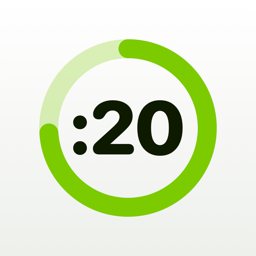
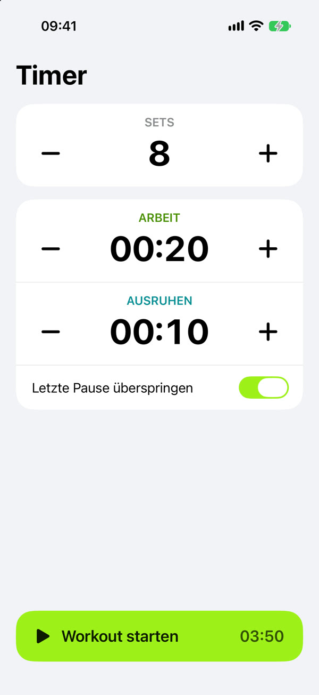
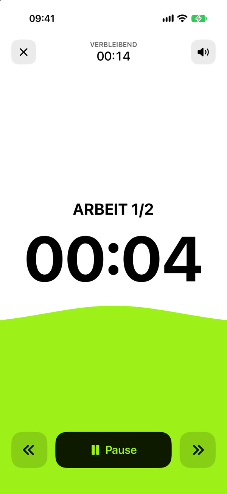
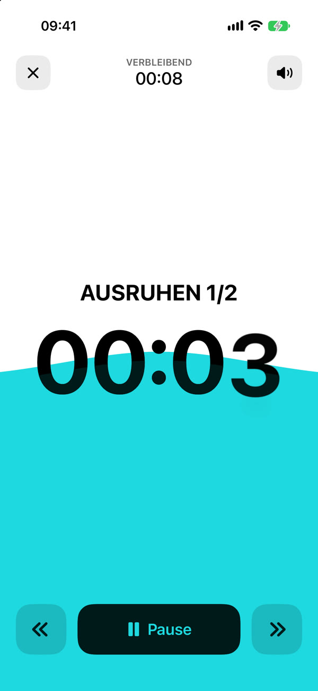
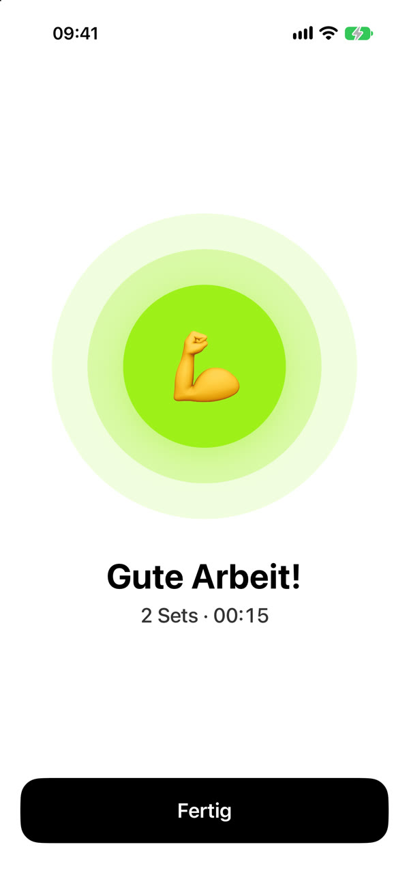
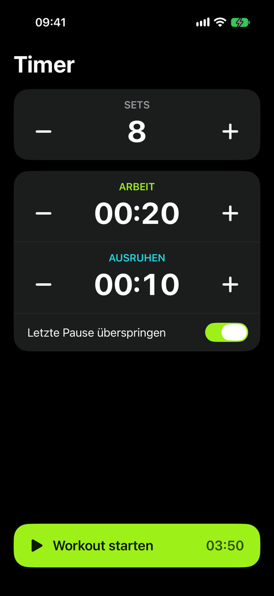
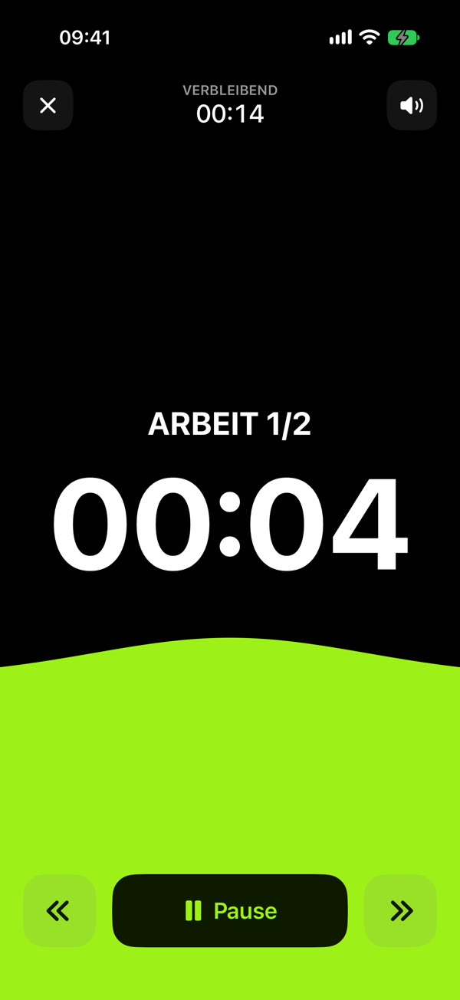
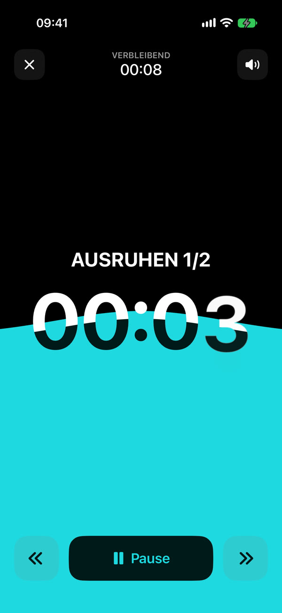
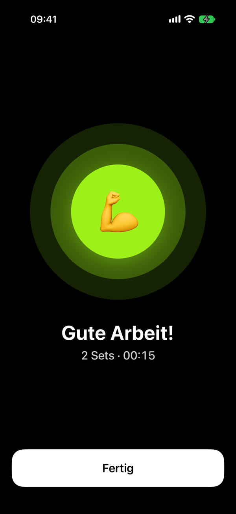

<p align="center"></p>

# Timer

A deliberately minimal Tabata and interval timer for iPhone. Set sets, work and rest, press start. No workout library, no history, no ratings, no ads, no network.

[](../../releases/latest) [](../../releases/latest) [](LICENSE)

<p align="center">
  
  
  
  
</p>
<p align="center">
  
  
  
  
</p>

## What it does

- **Sets, work and rest** on one screen. Times change in 5-second steps (hold + or − to repeat), everything is remembered for next time. Optionally skip the last rest.
- **10 seconds to get ready**, which you can skip.
- **A fill that rises with the time**: one calm surface with a soft hill grows from the bottom, lime while working, aqua while resting. Where it covers the time and the buttons, they switch colour so they stay readable.
- **Sound effects** for the countdown (3, 2, 1), the start of work, the start of rest and the end. They are synthesized in code, there are no audio files. Music or podcasts keep playing alongside. Sound can be muted from the timer screen.
- **Controls while running**: pause, back, skip, stop. The remaining total time is shown at the top.
- **Keeps running with the screen locked**: time is measured against the clock, so it stays exact. The screen stays on during a workout, and is released again while paused.
- **Light and dark mode**, following the system.

The user interface is in German.

## Install

Every release has an **unsigned `.ipa`** on the [Releases page](../../releases). iOS won't install an `.ipa` directly, so you re-sign it with your own Apple ID:

- **[AltStore](https://altstore.io)**: run AltServer on a Mac or PC, then open the `.ipa` in AltStore on the iPhone. A free Apple ID works, but the app stops launching after **7 days** until AltStore refreshes it (a paid Apple Developer account lasts a year).
- **[Sideloadly](https://sideloadly.io)**: connect the iPhone to a Mac or PC and load the `.ipa`. Same 7-day limit on a free Apple ID.

Timer requires **iOS 27 or later** and runs on iPhone only.

## Building

The Xcode project is generated with [XcodeGen](https://github.com/yonaskolb/XcodeGen) from `project.yml`. The generated project is checked in, so it opens in Xcode without XcodeGen; you only need it after changing `project.yml`.

```sh
brew install xcodegen      # once
xcodegen generate          # after editing project.yml
xcodebuild -project Timer.xcodeproj -scheme Timer \
  -destination 'generic/platform=iOS Simulator' build
```

Requires Xcode 27 (Swift 6, iOS 27 SDK). Signing is automatic with the team in `project.yml`; change `DEVELOPMENT_TEAM` to your own to run it on a device.

In debug builds, launching with `-demo` starts a short workout right away (2 sets, 5 s work, 5 s rest), which is handy for screenshots.

## Releasing

```sh
./scripts/build-ipa.sh     # archives unsigned and writes build/Timer-<version>.ipa
```

The version comes from `MARKETING_VERSION` in `project.yml`. Tag `v<version>` and attach the `.ipa` to a GitHub release.

## Structure

| File | What it is |
|---|---|
| `Timer/TimerApp.swift` | App entry, switches between setup and a running workout |
| `Timer/SetupView.swift` | Sets, work, rest, start button |
| `Timer/WorkoutModel.swift` | The workout: phases, timing against the clock, countdown ticks |
| `Timer/RunView.swift` | The running screen and the rising fill |
| `Timer/DoneView.swift` | End screen |
| `Timer/SoundPlayer.swift` | Sound synthesis and playback with `AVAudioEngine` |
| `Timer/Theme.swift` | Colours and time formatting |
| `tools/make-icon.swift` | Renders the app icon (light, dark, tinted) |

## License

[MIT](LICENSE)
